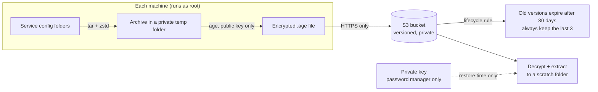

# lifeguard-s3-backup

Encrypted off-site backups of my home lab's service configs, stored in AWS S3.

Each service's config gets packed with `tar`, compressed with `zstd`, and encrypted on the machine with [age](https://github.com/FiloSottile/age) before it's uploaded. Only encrypted files ever leave the house. The private key that can decrypt them never touches the servers.

I built this by hand, in the AWS console and the shell.

> **Work in progress.** The manual pipeline is built and restore-tested on both machines. The scripts, systemd timers and alerting are next. See [Roadmap](#roadmap).

## How a backup flows



Two machines back up to one bucket:

| Machine | Role | What it backs up |
|---|---|---|
| Raspberry Pi | DNS and reverse proxy | Caddy, nebula-sync, Pi-hole settings |
| RHEL VM on Proxmox | Media and automation | Jellyfin, the arr stack, Pi-hole settings |

## AWS setup

### The bucket

| Setting | Why |
|---|---|
| Block Public Access, all four on | Backups should never be reachable from the internet. |
| Versioning on | Every upload to the same name keeps the old one as a previous version. That's the backup history. |
| Default encryption (SSE-S3) | Free and automatic. I skipped SSE-KMS: age already encrypts everything before upload, and KMS costs about $1 per key per month plus request fees. |
| Standard storage class | The cheaper classes charge minimum sizes and minimum storage days, which cost more for small files replaced every night. |
| Bucket policy: deny anything not over HTTPS | [`backup-s3-bucket-policy.json`](backup-s3-bucket-policy.json). It costs nothing and rules out unencrypted connections entirely. |
| Lifecycle: delete old versions after 30 days, keep at least 3 | Without it, storage grows forever. The "keep 3" floor means a quiet month can't expire every backup. |
| Lifecycle: delete incomplete multipart uploads after 7 days | Half-finished uploads otherwise sit there, and you pay for them without ever seeing them. |

### IAM: one user per machine, one shared policy

Each machine gets its own IAM user, with no console access and one access key for the CLI. If a key leaks, I revoke just that one. Both users sit in one group, with one policy attached: [`IAM-backup-policy.json`](IAM-backup-policy.json).

The policy uses the `${aws:username}` variable, so each user is fenced into a folder (prefix) matching its own name. When the Pi's user makes a request, AWS fills in its username, so the same rule means something different for each machine.

| Statement | Actions | Scope |
|---|---|---|
| `GetPutOwnPrefix` | `s3:PutObject`, `s3:GetObject` | Objects under `<bucket>/${aws:username}/*` |
| `ListOwnPrefix` | `s3:ListBucket` | The bucket, with a `StringLike` condition on `s3:prefix` = `${aws:username}/*` |

There's no delete permission. A compromised machine can't wipe its own backups.

I tested the fence from each machine before trusting it:

```
write to own folder           allowed
write to other machine's      AccessDenied
list own folder               allowed
list whole bucket             AccessDenied
delete own file               AccessDenied
```

What I learned setting it up:

- **`s3:ListBucket` needs its own statement.** It acts on the bucket itself, not on objects, so its Resource is the bare bucket ARN, and the condition narrows it to a prefix.
- **Leave the condition's qualifier empty.** `ForAllValues` is for multi-value keys, and it counts a request with *no* prefix as a match. That would let a plain "list the whole bucket" through.
- **`${aws:username}` is the IAM user, not the Linux login.** Whatever keys are on the machine decide who AWS thinks it is.

**Why not IAM Roles Anywhere?** It's the gold standard for machines outside AWS, because the credentials expire within an hour. But it means running my own certificate authority, and the certificate's private key still lives on the machine. With a one-folder, no-delete policy, long-lived keys are an acceptable tradeoff for two home machines. It's on the roadmap.

## On each machine

### Credentials live in `/etc`, not a home folder

```
/etc/homelab-backup/        drwx------  root root
├── aws-credentials         -rw-------  root root
├── aws-config              -rw-------  root root
└── age-recipients.txt      -rw-------  root root   # the age public key
```

The backup runs as root from a systemd timer, so its secrets belong somewhere only root can read. That keeps AWS keys out of my everyday accounts. I point the CLI at these files explicitly, because `sudo` is fuzzy about which home folder it uses, and that differs between RHEL and Raspberry Pi OS:

```
sudo AWS_SHARED_CREDENTIALS_FILE=/etc/homelab-backup/aws-credentials \
     AWS_CONFIG_FILE=/etc/homelab-backup/aws-config \
     /usr/local/bin/aws sts get-caller-identity    # should end in user/<machine>
```

What I learned setting it up:

- **Install the AWS CLI system-wide.** My first install landed in `~/.local/bin`. Root would have been running a program my normal user could modify, and that's a textbook privilege escalation path. Anything root runs should live somewhere only root can write.
- **Use the full path to `aws`.** On RHEL, `sudo` only searches `secure_path`, which doesn't include `/usr/local/bin`.
- **Run `restorecon` after `mv`-ing files into `/etc` on SELinux systems.** `mv` keeps the old `user_home_t` label, and a service can be denied reading its own keys while `chmod` looks perfectly fine. `cp` gives the file a fresh label instead.
- **The public key file's integrity matters.** If someone swapped in their own public key, every backup after that would be encrypted to them. Root-only ownership is what prevents it.

### The encryption key

I generated the age key pair on my workstation, not on a server. The private key lives only in my password manager. The servers only ever hold the public key, so a compromised server can make new backups but can't read any of them.

## What gets backed up

The rule: **back up what you can't recreate.** Anything already in Git, re-downloadable, or regenerated on startup gets skipped.

| Object | Contents | Skipped |
|---|---|---|
| `<vm>/jellyfin` | Config folder (databases, settings, plugins) and the compose file | Artwork, logs, cache, media |
| `<vm>/arr-stack` | Compose file; Sonarr, Radarr and Prowlarr's built-in backup zips; Seerr's config and database; qBittorrent's config | Logs, posters, live arr databases, Prowlarr definitions, torrent state, GeoIP database, Gluetun's server lists |
| `<vm>/network-stack` | `.env`, `docker-compose.override.yaml`, Pi-hole Teleporter export | Pi-hole's data folder. The rest is in [pihole-unbound-docker](https://github.com/JCBRobeson/pihole-unbound-docker). |
| `<pi>/caddy` | Dockerfile, compose file, `.env`, Caddyfile | Certificate and config volumes |
| `<pi>/nebula-sync` | Compose file, `.env` | |
| `<pi>/network-stack` | `.env`, `docker-compose.override.yaml`, Pi-hole Teleporter export | Pi-hole's data folder |

Objects are named `<machine>/<service>.tar.zst.age`. The extensions record each layer in the order it was applied, so a restore undoes them right to left.

### Why it's set up this way

- **Fixed names, with history from versioning.** No dates in the names. With dated names, S3 can only expire backups by age, and a quiet month with no uploads would expire every one of them. A fixed name lets the lifecycle rule keep "the last 3" without the machines ever needing delete permission.
- **Arr apps use their own backup zips, not copies of their databases.** A zip is the app-supported way to restore: System → Backup → Restore. They're only made weekly, so I accept losing up to a week of arr changes.
- **Whole folders minus junk, not a list of files to include.** Listing files to include is how things get missed. Including folders and excluding known junk picked up qBittorrent files that weren't on anyone's list.
- **Stop containers with a live database before archiving.** Jellyfin and the arr stack are stopped for the few seconds `tar` takes, so nothing is mid-write.
- **A SQLite database is the `.db` plus its `-wal`.** Seerr doesn't merge its write-ahead log on shutdown, so recent writes sit in the `-wal` file. Archiving the whole `db/` folder keeps them together. Backing up the `.db` alone would silently lose those changes.
- **Caddy re-issues its certificates.** Skipping the certificate volume keeps TLS private keys out of the backup. The only cost is Let's Encrypt's rate limit, around 5 duplicate certificates a week, if I rebuild Caddy over and over.
- **Teleporter export on the backup Pi-hole too.** It preserves the app password nebula-sync logs in with. Without it, every rebuild means generating a new app password and updating the sync config by hand.

### Change detection

Folders that don't change on their own get fingerprinted, and skipped when nothing changed:

```
cd <folder> && find . -type f -print0 | LC_ALL=C sort -z | xargs -0 sha256sum | sha256sum
```

It hashes every file, then hashes the list of `hash  path` lines. Because paths are part of that list, renamed, added and deleted files all change the result. `-print0`, `sort -z` and `xargs -0` keep filenames with spaces from breaking the list. `LC_ALL=C` sorts by raw bytes, so the order is the same on every machine.

I don't fingerprint Jellyfin. I tested it: Jellyfin writes to its databases every time it stops and starts. Since the backup itself stops and starts it, the fingerprint changes every night no matter what. Pi-hole's Teleporter export has a timestamp inside it, so the same goes for it. Both just upload nightly. They're small.

## Restoring

Restores go to a scratch folder first, never straight over live files. I do them in a root shell so file ownership comes back correctly.

```
sudo -i
umask 077                                  # anything this shell creates is root-only
RESTORE=$(mktemp -d /tmp/restore.XXXXXX)
read -rs AGE_KEY                           # paste the AGE-SECRET-KEY line; hidden, never on disk

AWS_SHARED_CREDENTIALS_FILE=/etc/homelab-backup/aws-credentials \
AWS_CONFIG_FILE=/etc/homelab-backup/aws-config \
/usr/local/bin/aws s3 cp "s3://<bucket>/<machine>/<service>.tar.zst.age" "$RESTORE/"

age -d -i <(printf '%s\n' "$AGE_KEY") -o "$RESTORE/<service>.tar.zst" "$RESTORE/<service>.tar.zst.age"
unset AGE_KEY

mkdir "$RESTORE/<service>"
tar --zstd -xpf "$RESTORE/<service>.tar.zst" -C "$RESTORE/<service>"
```

`<( ... )` hands age the key as a temporary file that only exists in memory. `printf` is a shell builtin, so the key never shows up in the process list either.

Check the result with `diff -r` against the live files, then clean up with `rm -rf -- "${RESTORE:?}"`. The `:?` makes the command fail if the variable is ever empty, instead of deleting the wrong thing.

I've restored every archive from both machines this way, and all of them matched the live files.

### Rebuilding the VM from scratch, in order

1. **Rebuild the host, creating the users first.** tar restores owners by name, so the users need to exist before extracting. Recreate the media folder layout too.
2. **Restore Jellyfin.** That brings back its API key, which Seerr uses.
3. **Start Sonarr, Radarr and Prowlarr, then restore each one's zip** from System → Backup. The zips are already in place from the archive. This brings back their original API keys.
4. **Start Seerr.** Its settings now point at matching keys.
5. **Start Gluetun and qBittorrent.** The VPN key lives in the compose file, so the forwarded port doesn't change.

## Security

- Nothing in this repo should contain a real bucket name, AWS account ID, hostname, IP address or key. Use placeholders like `<bucket>`.
- Teleporter exports include the Pi-hole admin password hash. Treat them as secrets.
- Clear your clipboard after pasting the age private key.
- `pihole-FTL --teleporter` with a filename **imports** instead of exporting. Never pass it a filename in a backup script.

## Known limitations

- **Arr images are on `:latest`.** Restoring a backup into an *older* app version fails, so they need pinning.
- **Host-level config isn't backed up yet.** Networking, firewall and SSH settings in `/etc` are covered by my rebuild runbooks for now, and later by Ansible.
- **Docker's SELinux support is off on the VM.** When I turn it on, `:z`/`:Z` labels will handle relabeling restored files.
- **Long-lived access keys.** See the note on Roles Anywhere above.

## Roadmap

- Backup scripts, one per machine
- systemd timers with `Persistent=true`, so a run missed while a machine was off still happens
- A heartbeat on every run, with SNS alerts when a backup goes quiet
- A full disaster-recovery drill on a throwaway VM, timed and written up
- A second age recipient whose private key only exists on paper
- Pin the arr image versions
- Terraform for the AWS side
- IAM Roles Anywhere instead of long-lived keys
- Object Lock
